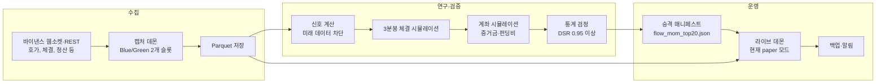

# crypto-pilot

**바이낸스 무기한 선물 시장을 대상으로, 전략 검증(백테스트)부터 24시간 자동 집행(현재는 모의 모드)까지 한 저장소에서 다루는 코인 자동 투자 프로젝트**

[](./pyproject.toml) [](./pyproject.toml) [](./docker-compose.yml) [](./.github/workflows/deploy.yml)

> [!NOTE]
> 이 README의 수익률은 모두 **과거 데이터로 다시 돌려 본 시뮬레이션(재현 시뮬레이션)** 값이며, **실제 계좌 수익이 아닙니다.** 24시간 데몬은 현재 `LIVE_MODE=paper`(주문을 내지 않고 체결만 가정하는 모의 모드)로 운영합니다([`docker-compose.yml`](./docker-compose.yml)).

## 🧭 개요

과거 데이터로 만든 전략은 실제로 돌리면 결과가 달라지기 쉽습니다. 이 프로젝트는 그 차이를 만드는 원인을 코드 단계에서 줄이는 데 초점을 둡니다.

- **미래 정보 사용**: 시점 t의 결정에 t 이후 데이터가 섞이지 않게 합니다.
- **체결 현실성**: 수수료, 펀딩비(무기한 선물에서 8시간마다 주고받는 비용), 지정가 주문의 미체결을 계산에 넣습니다.
- **강제청산**: 거래소의 유지증거금(포지션을 유지하려면 남겨야 하는 최소 증거금) 규칙을 계좌 시뮬레이션에 넣습니다.
- **여러 번 시도한 편향**: 전략 후보를 여러 번 시험해 좋은 결과만 고르는 문제를, 시험 횟수를 기록해 통계로 보정합니다.
- **운영 안정성**: 시세 수집이 끊기지 않게 하고, 매일 정해진 시각의 주문과 배포가 겹치지 않게 합니다.

전략은 `flow_mom_top20`입니다. 직전 거래대금 상위 20개 종목에서 주문 흐름 불균형(체결이 매수 쪽으로 쏠린 정도)과 가격 모멘텀 5가지 신호를 합쳐 순위를 매기고, 매일 00:00 UTC에 비중을 조정합니다([`targets.py`](./src/strategy/targets.py)).

## 🏗️ 시스템 구성



- 계층은 `core ← strategy ← engine ← evaluation` 한 방향으로만 의존하도록 정했고, 위반하면 [계약 테스트](./tests/contract/test_layer_imports.py)가 실패합니다. 실험용 `lab`은 배포 계층에서 가져다 쓸 수 없습니다.
- 하나의 CLI([`src/cli/main.py`](./src/cli/main.py))가 `data`, `backtest`, `evaluate`, `lab`, `live`, `ops`, `archive` 명령 그룹을 제공합니다.

## 🔧 핵심 설계 결정

각 결정을 **문제 → 분석(대안 비교) → 선택 → 결과** 순서로 정리했습니다.

### 🪙 1. 계좌 크기를 반영한 시뮬레이션과 레버리지 결정

- **문제:** 같은 신호도 레버리지를 높이면 수익이 커 보이지만, 급락 때 유지증거금이 모자라면 강제청산됩니다. 비중만 계산하는 백테스트는 최소 주문 수량 때문에 거절되는 주문도 반영하지 못합니다.
- **분석:** 전체 기간 수익률을 보고 고정 배율을 고르면 미래 정보를 쓴 셈이 됩니다. 그래서 (a) 고정 배율과 (b) 과거 수익만으로 매일 배율을 다시 정하는 방식을 비교했습니다.
- **선택:** (b)를 택했습니다. 신호 수익률의 분포를 시점마다 갱신해 기대 로그 성장이 가장 큰 배율을 고르고, 배율 상한 10배와 증거금 한도(초기 증거금의 90%)를 둡니다([`sizing.py`](./src/strategy/sizing.py), [`params.py`](./src/core/params.py)). 계좌 시뮬레이터는 심볼별 유지증거금 구간, 펀딩비, 수수료, 최소 주문 단위를 반영합니다([`account_ledger.py`](./src/engine/account_ledger.py)).
- ✅ **결과:** 아래 결과 표의 $1,000 시나리오에서 강제청산이 발생하지 않았습니다.

### ⏱️ 2. 3분봉 단위 체결 시뮬레이션

- **문제:** 1시간봉 종가에 바로 체결된다고 가정하면 수수료, 호가 차이, 지정가 미체결이 모두 빠집니다.
- **분석:** 즉시 시장가(테이커)는 체결은 확실하지만 수수료가 높습니다(이 프로젝트 설정: 테이커 6bp, 메이커 2bp, 1bp = 0.01%). 지정가(메이커)는 싸지만 체결이 안 될 수 있습니다.
- **선택:** 지정가 중심 집행으로 정하고, 주문 시점 이후 3분봉 10개 구간(30분) 동안 가격이 지정가를 지나간 만큼만 체결로 인정합니다. 5.25년치 3분봉을 한 번에 올리면 메모리가 부족해 월 단위로 나눠 읽으며 보유 수량과 대기 주문을 다음 구간으로 넘깁니다([`src/engine/execution/`](./src/engine/execution)).
- ✅ **결과:** 월 단위 처리 결과가 전체 한 번에 처리한 결과와 같은지 [동치 테스트](./tests/unit/engine/test_replay_accumulator.py)로 확인합니다.

### 🧪 3. 여러 번 시도한 편향 보정

- **문제:** 전략 후보를 계속 바꿔 시험하면 우연히 좋은 결과가 나온 후보를 고르게 됩니다.
- **분석:** 최종 결과 하나만 보고 판단하면 시도 횟수가 숨겨집니다.
- **선택:** 시험할 때마다 기록을 남기고([`flow_mom.trials.jsonl`](./src/strategy/releases/flow_mom.trials.jsonl), 52줄), 이 횟수를 반영한 DSR(Deflated Sharpe Ratio, 시도 횟수만큼 샤프지수를 깎아 보는 지표)이 0.95 이상일 때만 승격합니다([`통계 검정`](./src/evaluation/statistics.py)). 설계에 쓴 데이터는 2026-07-01까지로 고정하고, 그 이후 구간(홀드아웃)은 따로 남겨 두었습니다([`holdout.jsonl`](./src/strategy/releases/flow_mom.holdout.jsonl)).
- ✅ **결과:** 승격 매니페스트에 기준값(`dsr_min` 0.95)과 판정(`accept`)이 기록되어 있습니다([`flow_mom_top20.json`](./src/strategy/releases/flow_mom_top20.json)).

### 🔁 4. 결정 시각과 겹치지 않는 무중단 배포

- **문제:** 매일 정해진 시각의 주문 직전·직후에 배포하면 주문이 지연되거나 시세 수집이 끊길 수 있습니다.
- **분석:** 컨테이너를 매번 재시작하면 간단하지만 웹소켓이 끊겨 데이터가 비고, 배포 시각을 사람이 매번 피하기도 어렵습니다.
- **선택:** 수집 데몬을 Blue/Green 두 슬롯으로 두고, 수집 코드가 실제로 바뀐 경우에만 교대합니다. 바뀜 여부는 `src/capture/` 코드를 문법 트리(AST)로 정규화해 해시한 값으로 판단합니다([`capture_fingerprint.py`](./src/application/ops/capture_fingerprint.py), [`capture_handover.py`](./src/application/ops/capture_handover.py)). 결정 시각 전후와 라이브 락이 잡혀 있을 때는 배포를 기다립니다([`daemon_idle_gate.py`](./src/application/ops/daemon_idle_gate.py)).
- ✅ **결과:** 지문 계산과 대기 조건은 [단위 테스트](./tests/unit/application/test_capture_fingerprint.py)로 검증합니다.

### 🧾 5. 기록의 중복 방지와 비밀 보호

- **문제:** 세무용 거래 내역을 재수집하면 같은 건이 두 번 기록될 수 있고, 전략 결과물이 공개 저장소에 노출될 수 있습니다.
- **선택:** 거래 내역은 고유 키로 중복을 막는 원장에 저장하고([`tax_ledger.py`](./src/live/tax_ledger.py)), 배포용 비중 파일은 AES-256-GCM으로 암호화합니다([`crypto.py`](./src/live/crypto.py), [`artifact_seal.py`](./src/application/ops/artifact_seal.py)). 전략 기밀 노출은 [계약 테스트](./tests/contract/test_strategy_confidentiality.py)로 막습니다.

## 📊 결과

모두 **재현 시뮬레이션** 값입니다. 전략 `flow_mom_top20`, 지정가(maker) 집행, 수수료·펀딩비·증거금 규칙 반영, 설계 구간은 2021-04-01 ~ 2026-07-01입니다.

| 구분 | 구간 | 연복리 수익률(CAGR) | 최대 낙폭(MDD) | 강제청산 |
| :--- | :--- | :---: | :---: | :---: |
| 비중만 계산한 단위 북(1배 고정) | 2021-04 ~ 2026-07 | +44% ~ +49% | -14% ~ -18% | 해당 없음 |
| $1,000 계좌 시뮬레이션(설계 구간) | 2021-04 ~ 2026-07 | +220.4% | -51.2% | 0회 |
| ✅ $1,000 계좌 시뮬레이션(홀드아웃 포함) | 2021-04 ~ 2026-10 | **+212.7%** | -51.2% | 0회 |

- MDD는 3분봉 가격 경로 기준이고, 일별 종가 기준으로는 -46.3%입니다.
- 같은 실행의 부트스트랩(수익률을 무작위로 섞어 다시 계산) 결과 CAGR 5% 하위 값은 약 +107%, 중앙값은 약 +213%였습니다.

## ⚠️ 한계

- 모든 수익률은 시뮬레이션이며, **실제 돈으로 운용한 결과가 아닙니다.** 라이브 데몬은 아직 모의 모드입니다.
- 시뮬레이션의 평균 배율은 약 3.8배, 상한은 10배이고 낙폭이 -51%에 달해 실제 운용에서 버티기 어려운 수준입니다.
- 펀딩 손익의 약 91%가 상위 5개 종목에 몰려 있어 소수 종목 의존도가 높습니다.
- 초기 $1,000이 5.5년 후 수십만 달러가 되는 계산이므로, 거래 규모가 커질 때의 시장 충격은 모델 가정(충격 계수)에 크게 의존합니다.
- 홀드아웃 구간(2026-07 ~ 10)은 3개월이라 짧습니다.

## 🧱 기술 스택

| 구분 | 사용 기술 |
| :--- | :--- |
| 언어·도구 | Python 3.11, uv, Ruff, Pyright, pytest |
| 데이터 | pandas, NumPy, SciPy, PyArrow(Parquet) |
| 수집·거래소 | asyncio, aiohttp(수집), ccxt(주문) |
| 설정·보안 | Pydantic v2, cryptography(AES-256-GCM) |
| 운영 | Docker Compose, GitHub Actions(ARM64 빌드), systemd 타이머, rclone(Google Drive 백업) |

## 📂 프로젝트 구조

```text
src/
├── core/ market_data/ quant/   # 시계열 연산, 데이터 어댑터, 거래소 증거금 규칙
├── strategy/                   # 신호, 유니버스, 사이징, 승격 매니페스트(releases/)
├── engine/                     # 3분봉 체결(execution/), 계좌 시뮬레이터
├── evaluation/                 # DSR 등 통계 검정, 홀드아웃 관리
├── capture/                    # 웹소켓·REST 시세 수집 데몬
├── live/                       # 라이브 데몬, 집행기, 세무 원장
├── application/                # 유스케이스, Blue/Green 교대, 아티팩트 봉인
├── cli/                        # 단일 CLI 진입점
└── lab/                        # 실험용 (배포 계층에서 임포트 금지)
tests/{contract,unit,golden,benchmark}   # 계약 16개 파일, 단위, 골든, 벤치마크
deploy/                                  # 백업·생존 확인·아카이브 systemd 유닛과 스크립트
```

## 🚀 시작하기

시장 데이터(`data/`)는 저장소에 포함되지 않아 백테스트를 그대로 재현할 수는 없습니다. 환경 구성과 검사는 다음처럼 실행합니다.

```bash
uv sync --frozen                         # Python 3.11
uv run python tools/verify.py            # Ruff + Pyright + pytest 통합 검사
uv run pytest tests/contract/ -q         # 구조 계약 테스트

# 데이터가 준비된 경우: 계좌 시뮬레이션 예시
uv run python -m src.cli.main backtest account \
  --strategy flow_mom_top20 --start 2021-04-01 --end 2026-10-01 \
  --initial-capital 1000 --sizing-policy growth --execution-mode maker
```

## 🤖 개발 과정에서의 AI 활용

AI 도구는 주로 코드 작성에 사용했고, 아이디어 정리와 도메인(선물 시장, 통계) 학습에도 썼습니다. **수치와 동작은 직접 확인했습니다.** 저장소에는 AI 작업 규칙 파일([`AGENTS.md`](./AGENTS.md), [`.agents/`](./.agents))이 포함되어 있습니다.
