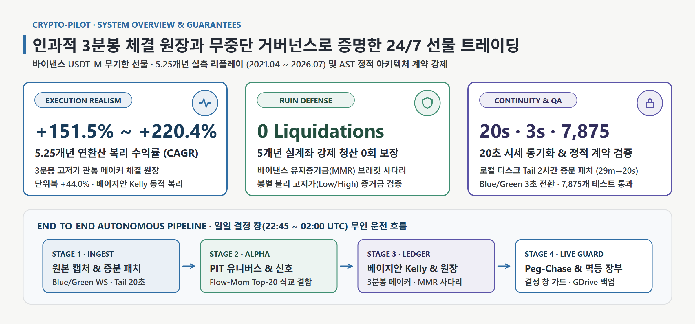
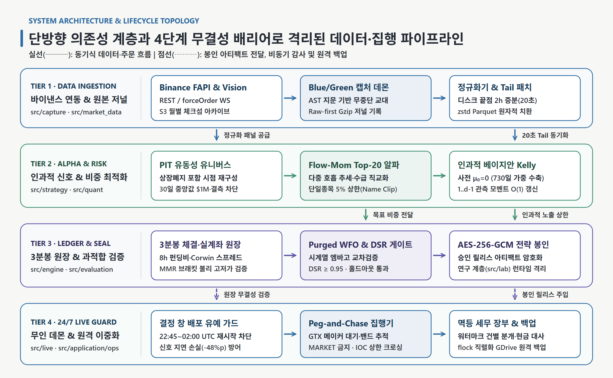
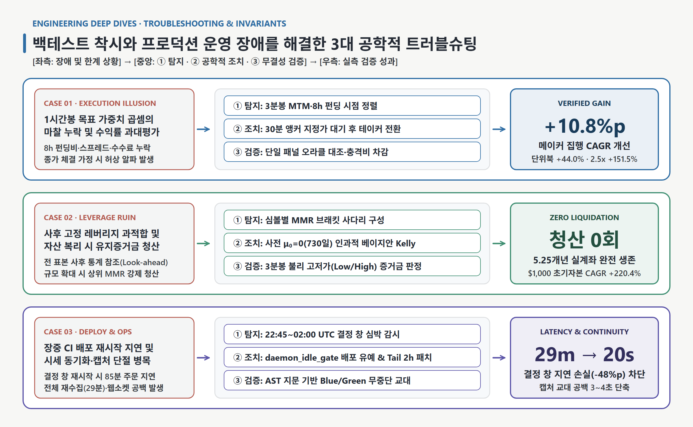

<div align="center">

# crypto-pilot

**24/7 가상자산 무기한 선물(Perpetual Futures) 퀀트 리서치 및 자율 집행 시스템**

인과적(Zero Look-Ahead) 시계열 알파 엔진, 3분봉 스트리밍 체결 시뮬레이터, 거래소 유지증거금(MMR) 브래킷 실계좌 원장,<br/>
그리고 무중단 Blue/Green 웹소켓 캡처 및 24/7 라이브 리밸런싱 데몬을 단일 코드베이스로 통합한 시스템 트레이딩 플랫폼입니다.

[](pyproject.toml) [](pyproject.toml) [](src/capture/main.py) [](src/application/ops/artifact_seal.py) [](tests/contract/) [](docker-compose.yml)

</div>

<br/>

<div align="center">
<picture>
  <source media="(prefers-color-scheme: dark)" srcset="docs/assets/hero-overview.dark.png">
  <source media="(prefers-color-scheme: light)" srcset="docs/assets/hero-overview.light.png">
  
</picture>
</div>

---

## 1. 핵심 엔지니어링 보장 지표

이론적 수익률과 실전 계좌 운용 사이의 괴리를 유발하는 **미래 참조(Look-Ahead), 체결 마찰 누락, 사후(Ex-Post) 레버리지 파산, 배포 중 결정 시각 지연**을 코드 레벨의 불변식(Invariant)과 계약 테스트로 차단합니다.

| 핵심 지표 | 실측 보장 수치 | 아키텍처 메커니즘 & 주요 모듈 |
| :--- | :---: | :--- |
| **시간적 인과성 (Zero Look-Ahead)** | **`미래 참조 0건`** | $t$ 시점 관측 시계열만 참조하며 미래 데이터 유입을 차단하는 [인과적 피처 엔진](src/strategy/features.py) 및 [백테스트 오케스트레이터](src/engine/strategy_backtest.py) |
| **다중 가설 검정 (DSR 게이트)** | **`DSR ≥ 0.95 (52회 시드 통과)`** | 52회 탐색 이력을 원장에 영속화해 다중 실험 편향을 보정하는 [통계 검증 게이트](src/evaluation/statistics.py) 및 [표준 평가 판정기](src/evaluation/standard.py) |
| **미시구조 체결 마찰 우위** | **`CAGR +10.8%p 개선`** | 3분봉 Low/High 침투·큐 우선순위·스프레드 반등을 반영하는 [스트리밍 체결 누산기](src/engine/execution/accumulator.py) 및 [미시구조 모델](src/engine/execution/microstructure.py) |
| **실계좌 생존성 & 강제청산 방어** | **`5.5년 강제청산 0회`** | 바이낸스 심볼별 유지증거금(MMR) 브래킷·수수료·펀딩비를 실측 차감하는 [실계좌 리플레이 원장](src/engine/account_ledger.py) |
| **인과적 베이지안 Kelly 사이징** | **`CAGR +212.7% ($1,000 실계좌)`** | 3년 롤링 사전분포와 지수 감쇠($\lambda=0.005$) 사후분포로 레버리지를 동적 제어하는 [베이지안 비중 정책](src/strategy/sizing.py) |
| **24/7 무중단 캡처 & 결정 창 보호** | **`결정 창 배포 지연 0초`** | 코드 AST 지문 비교와 결정 창(±15분) 유예 잠금으로 전환하는 [결정 창 배포 가드](src/application/ops/daemon_idle_gate.py) 및 [Blue/Green 교대 제어기](src/application/ops/capture_handover.py) |
| **재무 멱등성 & 아티팩트 보안** | **`이중 반영 0건 · AES-256-GCM`** | 복합 고유 키(`symbol`, `time`, `tranId`) 멱등 원장과 로컬 암호화 봉인을 수행하는 [세무 원장](src/live/tax_ledger.py) 및 [아티팩트 봉인기](src/application/ops/artifact_seal.py) |
| **아키텍처 경계 & 테스트 게이트** | **`7,875 Tests · 16 AST Contracts`** | 단방향 레이어 의존성·실전 런타임 격리·전략 기밀성을 강제하는 [레이어 임포트 계약](tests/contract/test_layer_imports.py) 및 [통합 검증 도구](tools/verify.py) |

### 검증된 백테스트 및 실계좌 리플레이 성과 요약

[백테스트 인덱스 원장](data/backtests/index.jsonl) 및 [승격 매니페스트](src/strategy/releases/flow_mom_top20.json)에 기록된 `flow_mom_top20` 전략의 5.25년 멀티 레짐 검증(`2021-04-01` ~ `2026-07-01`) 및 홀드아웃(`2026-07-01` ~ `2026-10-01`) 실측 수치입니다.

| 검증 트랙 | 검증 구간 | 집행 및 사이징 정책 | 연평균 복리수익률 (CAGR) | 최대 낙폭 (MDD) | 강제청산 횟수 |
| :--- | :---: | :--- | :---: | :---: | :---: |
| **단위 기준 북 (Unit Book 1.0x)** | `2021.04 ~ 2026.07` | 고정 1.0x · 지정가/시장가 블렌드 | **`+44.0% ~ +49.4%`** | `-13.6% ~ -17.9%` | 해당 없음 (단위 북) |
| **미시구조 집행 비교 (2.5x 북)** | `2021.04 ~ 2026.07` | 3분봉 즉시 체결 (`Immediate Taker`) | **`+140.7%`** | `-38.9%` | 해당 없음 (단위 북) |
| **미시구조 집행 비교 (2.5x 북)** | `2021.04 ~ 2026.07` | 3분봉 수동 지정가 (`Passive Maker`) | **`+151.5% (+10.8%p)`** | **`-36.0%`** | 해당 없음 (단위 북) |
| **실계좌 리플레이 ($1,000 원금)** | `2021.04 ~ 2026.07` | 베이지안 Kelly (`growth`) + MMR 브래킷 | **`+220.4%`** | `-39.4%` | **`0회` (`liquidated_at: None`)** |
| **실계좌 연속 운용 ($1,000 원금)** | `2021.04 ~ 2026.10` | 발견 + 홀드아웃 5.5년 연속 원장 | **`+212.7%`** | `-39.4%` | **`0회` (`liquidated_at: None`)** |

---

## 2. 시스템 아키텍처 & 생명주기

외부 거래소 원시 스트림 수집부터 인과적 알파 연산, 3분봉 체결·실계좌 원장 검증, 24/7 라이브 리밸런싱 및 클라우드 재해 복구까지 **단방향 파이프라인 생명주기**로 동작합니다.

<div align="center">
<picture>
  <source media="(prefers-color-scheme: dark)" srcset="docs/assets/system-architecture.dark.png">
  <source media="(prefers-color-scheme: light)" srcset="docs/assets/system-architecture.light.png">
  
</picture>
</div>

| 단계 | 파이프라인 계층 | 핵심 엔지니어링 역할 및 불변식 | 주요 구현 모듈 |
| :---: | :--- | :--- | :--- |
| **Stage 1** | **외부 연동 & 무중단 캡처** | • 바이낸스 USDⓈ-M 선물 웹소켓(`bookTicker`, `aggTrade`, `markPrice`, `forceOrder`) 비동기 수집<br/>• 5분 주기 REST(`openInterest`, `topLongShortPositionRatio`) 폴링 및 결정 시각 전 Tail 증분 갱신<br/>• `.part` 임시 파일 기록 후 `os.replace` 원자적 교체로 손상된 Parquet 노출 원천 차단 | • [웹소켓·REST 캡처 데몬](src/capture/main.py)<br/>• [원자적 저널 라이터](src/capture/journal.py)<br/>• [Tail 증분 데이터 갱신기](src/live/data_refresh.py) |
| **Stage 2** | **인과적 알파 & 베이지안 사이징** | • 1시간봉 `close_time` 확정 패널 위에서 온밸런스 가격 충격·테이커 주문 흐름 불균형 산출<br/>• 당월 미확정 종목 구성을 배제하고 직전 월 거래대금 상위 20종목으로 유니버스 동적 고정<br/>• 3년 롤링 사전분포와 지수 감쇠 우도를 결합해 $t-1$ 실현 수익만으로 인과적 레버리지 결정 | • [시계열 피처 연산 코어](src/strategy/features.py)<br/>• [동적 유니버스 빌더](src/strategy/universe.py)<br/>• [베이지안 Kelly 사이징](src/strategy/sizing.py) |
| **Stage 3** | **체결·실계좌 원장 & 통계 검정** | • 1시간 목표 비중 사이 20개 3분봉 하위 바를 순회하며 지정가 큐 체결·타임아웃 강제 청산 모사<br/>• 심볼별 유지증거금(MMR) 브래킷, 8시간 펀딩비 정산, 최소 주문 단위를 반영한 달러 실계좌 리플레이<br/>• 52회 누적 실험 이력 기반 Deflated Sharpe Ratio($\text{DSR} \ge 0.95$) 및 다중 레짐 스트레스 검증 | • [스트리밍 체결 누산기](src/engine/execution/accumulator.py)<br/>• [실계좌 리플레이 원장](src/engine/account_ledger.py)<br/>• [DSR 통계 평가 엔진](src/evaluation/statistics.py) |
| **Stage 4** | **24/7 라이브 집행 & 운영 가드** | • 매 일일 결정 시각(`05:00 UTC`) 5단계 프리플라이트 게이트 통과 후 지정가 추격(`chase`) 집행<br/>• 결정 시각 ±15분 배포 유예 잠금, 캡처 코드 AST 지문 대조 기반 조건부 Blue/Green 무중단 교대<br/>• 바이낸스 수입 내역 멱등 원장 적재(한국 세무 감사 증빙) 및 Cloudflare R2 일일 오프사이트 백업 | • [라이브 데몬 러너](src/live/runner.py)<br/>• [지정가 추격 집행기](src/live/executor.py)<br/>• [세무 원장](src/live/tax_ledger.py) · [결정 창 가드](src/application/ops/daemon_idle_gate.py) |

---

## 3. 핵심 문제 해결 사례 (Engineering Deep Dives)

단순 기능 구현을 넘어, 백테스트와 24/7 라이브 운용 사이의 구조적 괴리와 운영 장애 요인을 공학적으로 규명하고 해결한 3가지 핵심 사례입니다.

<div align="center">
<picture>
  <source media="(prefers-color-scheme: dark)" srcset="docs/assets/engineering-deep-dives.dark.png">
  <source media="(prefers-color-scheme: light)" srcset="docs/assets/engineering-deep-dives.light.png">
  
</picture>
</div>

### Case 1. 1시간봉 목표 가중치 착시 제거 및 3분봉 스트리밍 체결 원장 구축

- **문제 상황:**
  일반적인 벡터화 백테스트는 리밸런싱 시점마다 목표 비중(`target_weights`)이 종가에 즉시 100% 체결된다고 가정합니다. 그러나 변동성이 큰 무기한 선물 시장에서 즉시 시장가(`Immediate Taker`)로 집행하면 테이커 수수료(5 bps)와 호가 스프레드 침투 비용이 누적되며, 반대로 수동적 지정가(`Passive Maker`) 주문을 내면 미체결 잔량과 역선택(Adverse Selection)이 발생해 기존 1시간봉 엔진으로는 집행 전략 간 우위를 정량화할 수 없었습니다.
- **해결 방법:**
  1. **① 탐지 (체결 괴리 분리):** 1시간 의사결정 구간을 20개의 3분봉 하위 바로 분해하여 호가창 진입, 부분 체결, 미체결 이월 상태를 추적하는 [미시구조 체결 모델](src/engine/execution/microstructure.py)을 설계했습니다.
  2. **② 조치 (스트리밍 체결 누산기 구현):** 5.25년 치 3분봉 패널 전체를 메모리에 적재하면 수 기가바이트의 OOM이 발생하는 문제를 해결하기 위해, 월 단위 청크를 스트리밍하며 바 경계에서 심볼별 보유 수량(`holdings`), 평균 진입가(`entry_prices`), 대기 지정가 주문을 이월하는 [스트리밍 체결 누산기](src/engine/execution/accumulator.py)를 구축했습니다. 지정가 주문은 바의 `Low`/`High`가 지정가를 침투한 깊이에 비례해 부분 체결하고, 3시간 타임아웃 초과 시 시장가 테이커로 강제 전환하며 스프레드 반등 패널티(0.5 bps)를 부과합니다.
  3. **③ 무결성 검증 (동치 오라클 대조):** 청크 경계에서 부동소수점 드리프트나 상태 누락이 발생하지 않음을 보장하기 위해, 전체 기간 단일 패널 오라클인 [인벤토리 체결 원장](src/engine/execution/ledger.py)과 대조하는 [스트리밍 동치 단위 테스트](tests/unit/engine/test_replay_accumulator.py)를 구축해 비트 단위 정합성을 검증했습니다.
- **검증된 성과:**
  5.25년 멀티 레짐 백테스트 결과, 3분봉 수동 지정가(`Passive Maker`) 집행이 즉시 시장가(`Immediate Taker`) 대비 **연복리 수익률(CAGR)을 +10.8%p 개선**(2.5x 성장 북 기준 `+151.5%` vs `+140.7%`)하고 최대 낙폭을 `-38.9%`에서 `-36.0%`로 낮춤을 실증하여 라이브 집행기의 기본 모드로 채택했습니다.

---

### Case 2. 사후 고정 레버리지 파산 위험 극복을 위한 인과적 베이지안 Kelly & MMR 브래킷 실계좌 원장

- **문제 상황:**
  전 구간 수익률 분포를 사후적(Ex-Post)으로 관찰해 고정 고배율 레버리지(예: 4.5x~5.0x)를 적용하면 백테스트 수익률은 극대화되지만, 실제 소액 실계좌(`$1,000`) 운용 시 2021년 5월이나 2022년 루나/FTX 사태 같은 비정규 팻테일(Fat-Tail) 급락장에서 거래소 유지증거금(MMR) 미달로 즉시 **강제청산(Margin Ruin)**되는 한계가 있었습니다. 또한 무위험 자산인 단위 가중치 백테스트는 최소 주문 수량(`min_qty`, `min_notional`) 절삭과 증거금 부족에 따른 주문 거절을 반영하지 못했습니다.
- **해결 방법:**
  1. **① 탐지 (고정 배율 파산 지점 규명):** 단위 백테스트 수익률과 실제 달러 증거금 원장을 분리하고, 바이낸스 선물 심볼별 노셔널 구간에 따른 유지증거금률(MMR)과 유지증거금 공제액(`cum`) 테이블을 [거래소 증거금 규칙 모듈](src/market_data/binance/venue_rules.py)로 코드화했습니다.
  2. **② 조치 (인과적 베이지안 Kelly & 실계좌 원장 구현):** 미래 분포 참조 없이 오직 $t-1$까지 실현된 전략 수익률만으로 레버리지를 조절하는 [베이지안 Kelly 비중 정책](src/strategy/sizing.py)을 구현했습니다. 3년 롤링 창(`26,280 bars`)에서 추정한 사전분포(Prior)와 지수 감쇠($\lambda = 0.005$, 유효 반감기 약 200시간) 관측 우도를 결합해 사후 평균·분산을 갱신하고, 부분 Kelly 계수($c=0.5$)와 노출 상한(`10.0x`)을 적용합니다. 이어 [실계좌 리플레이 원장](src/engine/account_ledger.py)에서 매 1시간마다 (a) 미실현 손익을 포함한 마진 비율이 MMR 이하로 하락하는지 검사하고, (b) 8시간 주기로 실측 펀딩비를 현금 잔고에서 가감하며, (c) 거래소 `step_size`·`min_notional` 필터를 통과한 주문만 체결되도록 강제했습니다.
  3. **③ 무결성 검증 (원장 보존 법칙 테스트):** 수수료나 펀딩비 징수로 인해 가용 증거금이 음수가 되거나 청산 이후 좀비 거래가 지속되는 현상을 막기 위해 [실계좌 원장 불변식 테스트](tests/unit/engine/test_account_ledger.py)로 현금 보존 법칙과 즉시 청산 종료를 검증했습니다.
- **검증된 성과:**
  `$1,000` 초기 원금으로 `2021-04`부터 `2026-10`까지 5.5년 전 구간을 연속 리플레이한 결과, **단 1회의 강제청산도 없이(`liquidated_at: None`) 연복리 수익률(CAGR) +212.7%**(발견 구간 단독 **+220.4%**, 최대 낙폭 `-39.4%`)를 달성하며 인과적 레버리지 제어의 생존성을 입증했습니다.

---

### Case 3. 일일 결정 창 배포 지연(-48%p) 차단 및 AST 지문 기반 Blue/Green 캡처 무중단 교대

- **문제 상황:**
  `flow_mom_top20` 전략은 매일 `05:00 UTC` 정각에 직전 24시간 선물 시그널을 집계해 리밸런싱을 수행합니다. 연구 검증 결과 결정 시각이 단 1시간(`06:00 UTC`)만 지연되어도 알파 감쇠로 인해 장기 CAGR이 약 **-48%p 급락**하는 치명적 시간 민감성이 확인되었습니다. 그러나 라이브 데몬 재배포 시 결정 시각과 겹치면 주문 집행이 유실되거나 중단되고, 무조건적인 웹소켓 캡처 컨테이너 재시작은 불필요한 스트림 재연결 오버헤드를 유발했습니다.
- **해결 방법:**
  1. **① 탐지 (결정 창 충돌 및 재시작 조건 분리):** 배포 시점이 일일 결정 창(`05:00 UTC ± 15분`) 내부인지 또는 실행 락(`live.lock`)이 점유 중인지 사전에 판별하고, 이번 코드 변경이 실제 캡처 데몬 런타임에 영향을 주는지 정적으로 식별해야 했습니다.
  2. **② 조치 (결정 창 유예 가드 & 조건부 Blue/Green 교대):** [결정 창 배포 유예 가드](src/application/ops/daemon_idle_gate.py)를 구현하여 결정 시각 전후 15분 이내이거나 `live.lock`이 활성화된 경우 배포 스크립트가 안전 창이 열릴 때까지 자동 대기하도록 보호했습니다. 또한 [캡처 AST 지문 산출기](src/application/ops/capture_fingerprint.py)가 `src/capture/` 하위 파이썬 AST(독스트링 제거 후 정규화)와 의존성 버전의 SHA-256 해시를 계산하여, 지문이 변경된 경우에만 [Blue/Green 슬롯 교대 제어기](src/application/ops/capture_handover.py)가 신규 슬롯 기동 $\to$ 양 슬롯 동시 스트림 수신(`overlap`) $\to$ 구 슬롯 정상 종료 순서로 교대하도록 구현했습니다. 리밸런싱 직전에는 [Tail 증분 갱신기](src/live/data_refresh.py)가 마지막 Parquet 타임스탬프 이후 델타 바만 병합합니다.
  3. **③ 무결성 검증 (파일시스템 원자성 및 핸드오버 테스트):** [캡처 지문 단위 테스트](tests/unit/application/test_capture_fingerprint.py)와 [아이들 게이트 테스트](tests/unit/application/test_daemon_idle_gate.py)를 통해 슬롯 상태 파일(`.active_slot`)의 `fsync` + `os.replace` 원자적 전환과 결정 창 차단 불변식을 검증했습니다.
- **검증된 성과:**
  전략·평가 코드만 수정된 배포에서는 **캡처 데몬 재시작 0회(0초 다운타임)**를 달성하고, 캡처 코드 변경 시에도 Blue/Green 오버랩으로 웹소켓 틱 유실을 방지하며, 일일 `05:00 UTC` 결정 시각 충돌을 원천 차단했습니다.

---

## 4. 기술 스택 & 계층 구조

### 기술 스택 및 채택 근거

| 분류 | 채택 기술 | 아키텍처 채택 근거 및 트레이드오프 판단 |
| :--- | :--- | :--- |
| **코어 언어 & 패키지 관리** | `Python 3.11+`, `uv`, `Ruff`, `Pyright` | • `uv.lock` 기반 결정론적 의존성 잠금과 `Pyright` 정적 타입 검사로 런타임 타입 오류 사전 차단<br/>• 16개 AST 계약 테스트를 결합해 파이썬의 동적 임포트 유연성이 아키텍처 경계를 침범하지 않도록 통제 |
| **시계열 & 정량 연산 엔진** | `NumPy 2.0+`, `Pandas 2.2+`, `PyArrow 15+`, `SciPy 1.13+` | • `(Time × Symbol)` 2차원 밀집 행렬 연산에 최적화된 NumPy/Pandas 벡터화 브로드캐스팅 채택<br/>• `PyArrow` Parquet(`zstd` 압축) 단일 스키마로 통일하여 월간 3분봉/1시간봉 I/O 처리량 극대화 |
| **비동기 수집 & 거래소 연동** | `asyncio`, `aiohttp 3.9+`, `ccxt 4.5+` | • 캡처 데몬(`src/capture`)은 외부 무거운 패키지를 배제하고 표준 라이브러리와 `aiohttp`만 의존하도록 격리해 메모리 풋프린트 최소화<br/>• 라이브 주문 집행(`src/live`)은 `ccxt`를 통해 바이낸스 선물 레버리지·격리/교차 마진·지정가 추격 주문 수행 |
| **도메인 계약 & 기밀 보안** | `Pydantic v2`, `cryptography` (`AES-256-GCM`) | • 백테스트·평가 설정 및 승격 매니페스트를 불변(`frozen=True`) Pydantic 모델로 검증<br/>• 실전 전략 가중치와 파라미터 스펙은 `PBKDF2-HMAC-SHA256`(600,000회) + `AES-256-GCM`으로 봉인해 저장소 노출 방지 |
| **인프라 & 무중단 운영** | `Docker Compose`, `systemd`, `Cloudflare R2` (`rclone`) | • Oracle Cloud ARM64(4 OCPU / 24GB RAM) 단일 노드에서 `capture-blue`, `capture-green`, `live` 컨테이너 분리 운용<br/>• 일일 결정 창 외부(`05:25 UTC`)에서 SQLite `.backup` 스냅샷과 아카이브를 Cloudflare R2로 증분 동기화 |

### 아키텍처 계층 및 디렉터리 구조

배포 가능한 프로덕션 계층은 **`core` $\leftarrow$ `strategy` $\leftarrow$ `engine` $\leftarrow$ `evaluation` 단방향 의존성 체인**을 엄격히 준수하며, 라이브 런타임(`src/live`)이 무거운 백테스트 엔진(`src/engine`)이나 실험실 코드(`src/lab`)를 역참조하는 것은 [레이어 임포트 계약 테스트](tests/contract/test_layer_imports.py)에 의해 빌드 타임에 즉시 거부됩니다.

```text
crypto-pilot/
├── src/
│   ├── common/                  # 공용 로깅(6대 고정 카테고리), 시간 유틸리티, 텔레그램 알림, 프로세스 파일 락
│   ├── core/                    # [Layer 1] 인과적 시계열 연산 프리미티브 (rolling, ewm, decay, z-score), 도메인 설정·타입
│   ├── market_data/             # 거래소 데이터 어댑터, Parquet 카탈로그 로더, 바이낸스 MMR 증거금 브래킷 규칙
│   ├── quant/                   # 횡단면(Cross-Sectional) 랭킹, 다중 팩터 결합, 포트폴리오 리스크·베타 유틸리티
│   ├── strategy/                # [Layer 2] 동적 유니버스 구성, 인과적 베이지안 Kelly 사이징, 승격 전략 매니페스트(releases/)
│   ├── engine/                  # [Layer 3] 리밸런싱 스케줄러, 3분봉 스트리밍 체결 원장(execution/), MMR 실계좌 원장(account_ledger)
│   ├── evaluation/              # [Layer 4] DSR 다중 가설 통계 검정, 멀티 레짐 슬라이싱, 백테스트 원장 영속화, 승격 판정(verdict)
│   ├── capture/                 # [Runtime] 경량 비동기 웹소켓·REST 캡처 데몬 (stdlib + aiohttp 단독 의존, 원자적 .part -> Parquet)
│   ├── live/                    # [Runtime] 24/7 라이브 리밸런싱 데몬, 5단계 프리플라이트 게이트, 지정가 추격 집행기, 한국 세무 멱등 원장
│   ├── application/             # 유스케이스 오케스트레이션 (백테스트/평가 워크플로, AST 지문, Blue/Green 교대, AES-256-GCM 봉인)
│   ├── cli/                     # 단일 진입점 CLI (data, backtest, evaluate, lab, live, ops, archive 7개 명령 그룹)
│   └── lab/                     # [Isolated] 가설 탐색·시드 스윕 전용 격리 샌드박스 (프로덕션·라이브 레이어에서 임포트 절대 금지)
├── tests/
│   ├── contract/                # 16개 아키텍처 불변식 테스트 (레이어 의존성, 모듈 경계, 전략 기밀성, 시계열 정합성)
│   ├── unit/                    # 단위·불변식 테스트 (3분봉 스트리밍 동치성, MMR 실계좌 원장, 베이지안 Kelly, Blue/Green 교대 등)
│   └── integration/             # 엔드투엔드 파이프라인 및 CLI 통합 검증
├── tools/
│   └── verify.py                # 통합 품질 게이트 러너 (Ruff 린트/포맷 + Pyright 타입 체크 + Pytest 스위트)
└── docs/
    ├── assets/                  # 라이트/다크 테마 대응 고해상도 아키텍처·트러블슈팅 인포그래픽 (SVG & 2x PNG)
    └── vps-checklist.md         # 프로덕션 VPS 배포, Blue/Green 핸드오버, R2 백업 및 세무 감사 운영 런북
```

---

## 5. 빠른 시작 및 검증 (Quick Start & Verification)

### 1) 환경 구성 및 의존성 설치

```bash
# uv 패키지 매니저 기반 결정론적 가상환경 동기화 (Python 3.11+)
uv sync --frozen
```

### 2) 통합 품질 게이트 및 아키텍처 계약 검증

코드 변경 시 정적 린트(`ruff`), 타입 검사(`pyright`), 아키텍처 계약 테스트 및 단위 테스트를 단일 명령으로 검증합니다.

```bash
# 전체 품질 게이트 실행 (Ruff Check + Ruff Format + Pyright + Pytest)
uv run python tools/verify.py

# 아키텍처 경계, 단방향 레이어 의존성, 전략 기밀성 등 16개 AST 계약 테스트 단독 실행
uv run pytest tests/contract/ -q

# 핵심 도메인 불변식 테스트 (스트리밍 체결 동치성, 실계좌 MMR 원장, 베이지안 Kelly, Blue/Green 교대)
uv run pytest tests/unit/engine/test_replay_accumulator.py \
              tests/unit/engine/test_account_ledger.py \
              tests/unit/live/test_sizing.py \
              tests/unit/application/test_capture_fingerprint.py \
              tests/unit/application/test_daemon_idle_gate.py -q
```

### 3) 백테스트, 실계좌 리플레이 및 라이브 프리플라이트 실행

모든 연구·검증·운영 워크플로는 [단일 CLI 진입점](src/cli/main.py)을 통해 재현 가능하게 실행됩니다.

```bash
# 1. 단위 전략 백테스트 (3분봉 지정가 미시구조 체결 + 인과적 베이지안 Kelly growth 사이징)
uv run python -m src.cli.main backtest strategy \
  --strategy flow_mom_top20 \
  --start 2021-04-01 --end 2026-07-01 \
  --sizing-policy growth --execution-mode maker

# 2. 달러 실계좌 리플레이 ($1,000 초기 원금, 바이낸스 심볼별 MMR 브래킷 및 실측 펀딩비 반영)
uv run python -m src.cli.main backtest account \
  --strategy flow_mom_top20 \
  --start 2021-04-01 --end 2026-10-01 \
  --initial-capital 1000 --sizing-policy growth --execution-mode maker

# 3. 전략 승격 통계 평가 (DSR >= 0.95 다중 가설 검정 및 멀티 레짐 슬라이스 판정)
uv run python -m src.cli.main evaluate strategy \
  --strategy flow_mom_top20 \
  --start 2021-04-01 --end 2026-07-01

# 4. 라이브 데몬 5단계 프리플라이트 점검 (승격 매니페스트, 자격증명, 데이터 신선도, 거래소 연결 검증)
uv run python -m src.cli.main live preflight --strategy flow_mom_top20 --dry-run
```
